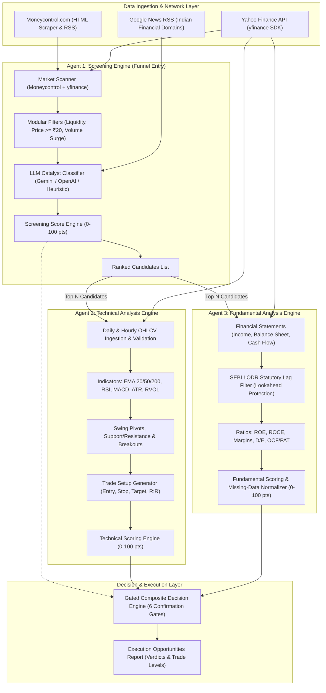
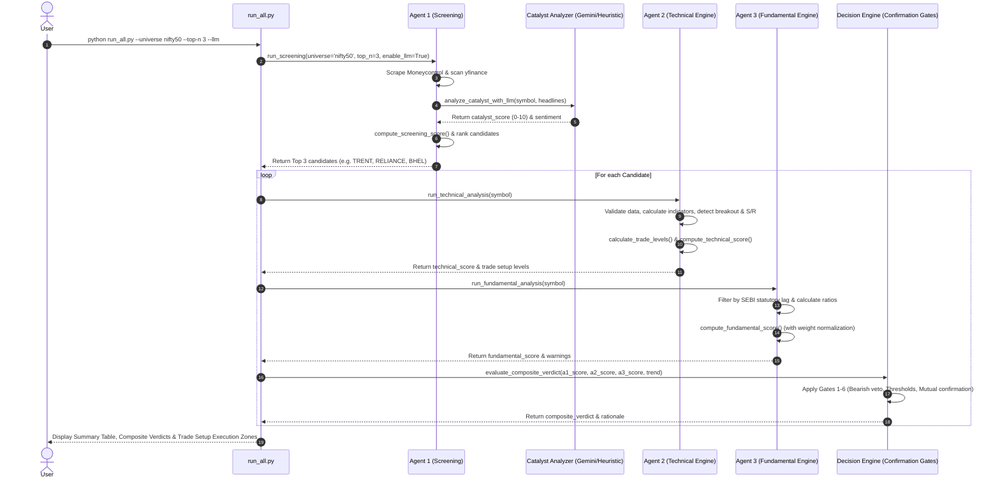

# PROJECT INTELLIGENCE & AGENT-BY-AGENT AUDIT REPORT
**System:** SwingTrade AI (Indian Equities Multi-Module Trading System)  
**Repository Working Directory:** `c:\Users\sinan\OneDrive\Desktop\PROJECTS\Swing-AI`  
**Audit Date:** 2026-10-15  
**Auditor:** Senior Software Architect, AI Systems Analyst & Code Auditor  
**Audit Scope:** Full codebase discovery, agent classification, module audit, execution traces, tests, bugs, security, and verification.

---

## 1. Executive Summary

This audit presents an exhaustive, ground-truth inspection of the **SwingTrade AI** repository. Every source file, configuration manifest, test suite, and CI workflow was analyzed directly from source code and runtime execution.

### Key Audit Conclusions:
1. **Nature of the System:** Despite being marketed as an "AI Multi-Agent Trading System," the repository is almost entirely a **deterministic, quantitative finance and algorithmic screening pipeline**. It features rule-based mathematical models (EMAs, RSI, MACD, Wilder's ATR, volume expansions, financial statement ratios, and SEBI-compliant reporting lag filters).
2. **AI Agent Reality:** There are **no autonomous AI agents** in the classical sense (no autonomous planning loops, no multi-step tool-calling agents, no persistent conversational memory, and no agentic frameworks like LangChain, CrewAI, or AutoGen). However, there is **one real LLM integration**: a zero-shot REST API classifier in `src/screening/llm/catalyst_analyzer.py` that queries Google Gemini (`gemini-1.5-flash`) or OpenAI (`gpt-4o-mini`) to evaluate sentiment on news headlines, falling back to a deterministic heuristic keyword engine when offline or uncredentialed. Conversely, `src/fundamental/output/llm_explainer.py` contains **zero LLM code**, despite its name; it is 100% hardcoded Python f-string template formatting.
3. **Execution Gating & Architecture:** The system employs a strict 4-stage funnel: **Universe Screening (Agent 1) $\rightarrow$ Technical Analysis Engine (Agent 2) $\rightarrow$ Fundamental Quality Engine (Agent 3) $\rightarrow$ Gated Composite Verdict Engine**. A crucial design triumph is the multi-agent gating logic (`src/screening/output/pipeline.py`), which strictly prevents fundamental health from overriding bearish technicals on swing long setups.
4. **Test Suite Integrity:** The repository contains an automated test suite of **79 unit and regression tests** under `pytest`. All 79 tests were executed during this audit and passed cleanly in 16.36 seconds without external network access or credentials.
5. **Critical Finding / Defect:** A significant defect was uncovered in single-stock pipeline execution (`run_all.py` / `src/screening/main.py`). When running `--symbol <SYM>` (especially in offline mode), the screening routine loads all cached stocks and returns the top-ranked stock (often `TRENT`) rather than filtering for `<SYM>`. As a result, when analyzing stocks like `RELIANCE` or `INFY`, the screening score and tags of `TRENT` are erroneously bound into the single-stock report and composite verdict.

---

## 2. What the Project Actually Does

In plain English, **SwingTrade AI** is a command-line quantitative swing-trading decision support system designed specifically for the **National Stock Exchange of India (NSE)**.

### Core Workflow:
1. **Universe Screening (Agent 1):** Scrapes live market stats from Moneycontrol (Volume Shockers, 52-Week Highs, Top Gainers, Most Active) and executes batch technical scans via Yahoo Finance across NIFTY 50, NIFTY Next 50, or custom watchlists. It filters out illiquid and penny stocks (< ₹20), evaluates momentum and volume surges, and scores candidates on a 0–100 scale. If enabled (`--llm`), it fetches news headlines from Indian financial portals and scores near-term catalysts using Gemini, OpenAI, or a keyword heuristic.
2. **Deep Technical Analysis (Agent 2):** For screened candidates or any designated NSE stock, it downloads daily and hourly OHLCV data. It calculates 20/50/200 EMAs and their 5-day normalized slopes, Wilder's 14-period RSI, MACD (12, 26, 9), Relative Volume (RVOL), and 14-period ATR. It detects 20-day and 50-day price breakouts without look-ahead bias, locates nearest swing support and resistance levels, benchmarks 1-month relative performance against the NIFTY 50 (`^NSEI`) and sectoral indices, scores technical viability on a 0–100 point rubric, and computes exact swing trade levels (Entry Zone, Stop Loss based on $1.5 \times \text{ATR}$, Target 1, Target 2, and Risk:Reward).
3. **Fundamental Health Analysis (Agent 3):** Fetches quarterly and annual income statements, balance sheets, and cash flow statements via Yahoo Finance. It calculates YoY and QoQ revenue/PAT growth, 3-year CAGR, ROE, ROCE, operating/net margins, Debt-to-Equity, Net Debt, Interest Coverage, Current Ratio, Operating Cash Flow (OCF), Free Cash Flow (FCF), and the crucial earnings-to-cash conversion ratio (OCF/PAT). It applies a SEBI LODR statutory publication lag (45 days for quarters, 60 days for annuals) to eliminate look-ahead bias in historical evaluations, exempts banks and NBFCs from corporate balance sheet leverage penalties, compares multiples (P/E, P/B, EV/EBITDA) against predefined sector benchmarks, detects accounting anomalies, and normalizes scores (0–100) dynamically if non-critical metrics are missing.
4. **Composite Verdict Layer (Decision Engine):** Aggregates screening, technical, and fundamental scores into a unified composite score (0–100) and assigns an actionable verdict: `STRONG_BUY_CANDIDATE`, `MODERATE_BUY_CANDIDATE`, `WATCHLIST_WAIT_FOR_SETUP`, `SPECULATIVE_TECHNICAL_ONLY`, `REJECTED_BEARISH`, `NOT_RECOMMENDED`, or `INSUFFICIENT_DATA_HOLD`.

---

## 3. Technology Stack and Runtime Architecture

| Layer | Component / Technology | Exact Version / Spec |
|---|---|---|
| **Runtime Language** | Python | 3.11, 3.12, 3.14 compatible (tested on 3.14.5) |
| **Data Processing & Math** | Pandas, NumPy | `pandas>=2.0.0`, `numpy>=1.24.0` |
| **Configuration** | PyYAML | `pyyaml>=6.0.0` |
| **Testing Framework** | Pytest | `pytest>=8.0.0` |
| **Networking & HTTP** | Requests | `requests>=2.31.0` |
| **HTML / XML Parsing** | BeautifulSoup4 | `beautifulsoup4>=4.12.0` |
| **Market Data Provider** | Yahoo Finance SDK | `yfinance>=0.2.35` |
| **AI / LLM Integration** | Google Gemini REST API & OpenAI REST API | Direct HTTP REST calls via `requests` (`gemini-1.5-flash`, `gpt-4o-mini`) |
| **Fallback NLP** | Rule-Based Heuristic Matcher | Case-insensitive regex/keyword weighting with corporate context |
| **Storage / Caching** | Local Filesystem Cache | `data/raw/*.csv` (OHLCV) and `data/raw/*.json` (Financials/Screening) |
| **Execution Environment** | CLI Console | UTF-8 with cp1252 Windows fallbacks |

---

## 4. Repository Structure

```text
c:\Users\sinan\OneDrive\Desktop\PROJECTS\Swing-AI\
├── .github/
│   └── workflows/
│       └── agent_1_ci.yml             # GitHub Actions CI matrix (Ubuntu, macOS, Windows; Py 3.11, 3.12)
├── config/
│   ├── settings.yaml                 # Agent 2 technical indicator periods, weights, benchmarks & sector map
│   ├── fundamental_settings.yaml     # Agent 3 fundamental weights, thresholds, and sector median benchmarks
│   └── screening_settings.yaml       # Agent 1 screening weights, thresholds, universes & Moneycontrol endpoints
├── data/
│   └── raw/                          # Local disk cache for market data CSVs and financial JSONs
├── outputs/
│   └── examples/                     # Canonical schema JSON samples (reliance_analysis, reliance_fundamental, screening_candidates)
├── src/
│   ├── __init__.py
│   ├── main.py                       # Agent 2 Technical Analysis Engine orchestrator and CLI
│   ├── analysis/                     # Technical analysis algorithms
│   │   ├── __init__.py
│   │   ├── breakout.py               # 20-day and 50-day breakout detection (excluding current candle)
│   │   ├── daily_analysis.py         # Daily EMA trend, slopes, and swing pivot market structure
│   │   ├── hourly_analysis.py        # Hourly trend alignment and intraday structure
│   │   ├── relative_strength.py      # Outperformance vs NIFTY 50 and sectoral indices (1w, 1m, 3m)
│   │   ├── support_resistance.py     # Nearest confirmed swing support and overhead resistance
│   │   └── trend_analysis.py         # Multi-timeframe trend alignment synthesis
│   ├── data/                         # Agent 2 data acquisition and validation
│   │   ├── __init__.py
│   │   ├── benchmark_data.py         # NIFTY 50 and sector benchmark retrieval
│   │   ├── market_data.py            # Daily/Hourly OHLCV fetching, yfinance provider formatting, caching & synthetic fallback
│   │   └── validator.py              # Strict OHLCV structural validation and candle count checks
│   ├── fundamental/                  # Agent 3 Fundamental Analysis Engine
│   │   ├── __init__.py
│   │   ├── main.py                   # Agent 3 orchestrator and CLI
│   │   ├── analysis/                 # Accounting analysis submodules
│   │   │   ├── __init__.py
│   │   │   ├── balance_sheet.py      # D/E, Net Debt, Interest Coverage, Current Ratio, Bank/NBFC exemption
│   │   │   ├── cash_flow.py          # OCF, FCF, OCF/PAT ratio with strict period granularity matching
│   │   │   ├── earnings_quality.py   # Cash conversion, revenue/PAT divergence, solvency anomalies
│   │   │   ├── growth.py             # YoY quarterly growth, 3-year CAGR, 4-quarter TTM growth
│   │   │   ├── ownership.py          # Promoter/Insider & Institutional holding percentages
│   │   │   ├── profitability.py      # ROE, ROCE, Operating Margin, Net Margin, Margin Trend
│   │   │   └── valuation.py          # P/E, P/B, EV/EBITDA vs sector median benchmarks
│   │   ├── data/                     # Financial statement ingestion
│   │   │   ├── __init__.py
│   │   │   ├── company_data.py       # Profile, sector classification, market cap categorizer
│   │   │   ├── financial_data.py     # Statement acquisition, SEBI statutory lag lookahead filter, synthetic statements
│   │   │   ├── market_data.py        # Trailing P/E, Forward P/E, P/B, Dividend Yield fetcher
│   │   │   └── validator.py          # Completeness and data quality tracker (FundamentalDataQuality)
│   │   ├── events/                   # Corporate calendar
│   │   │   ├── __init__.py
│   │   │   └── corporate_events.py   # Upcoming earnings results detection (30-day window)
│   │   ├── output/                   # Output formatting
│   │   │   ├── __init__.py
│   │   │   ├── formatter.py          # Section 23 canonical fundamental JSON formatter
│   │   │   └── llm_explainer.py      # Rule-based natural language report generator (misleadingly named "llm")
│   │   ├── ratios/                   # Pure ratio math formulas
│   │   │   ├── __init__.py
│   │   │   └── financial_ratios.py   # Pure math functions (operating margin, ROE, ROCE, D/E, OCF/PAT)
│   │   └── scoring/                  # Fundamental scoring
│   │       ├── __init__.py
│   │       └── fundamental_score.py  # 100-point rubric with dynamic weight renormalization for missing metrics
│   ├── indicators/                   # Mathematical technical indicators
│   │   ├── __init__.py
│   │   ├── momentum.py               # Wilder's RSI (span alpha=1/14), MACD (12, 26, 9), crossover detection
│   │   ├── moving_averages.py        # EMA 20, 50, 200 and 5-period normalized slope
│   │   ├── volatility.py             # Wilder's True Range, ATR(14), ATR%
│   │   └── volume.py                 # Relative Volume (RVOL) against shifted 20-period rolling average
│   ├── output/                       # Agent 2 output formatting
│   │   ├── __init__.py
│   │   └── formatter.py              # Section 19 canonical technical JSON and error formatters
│   ├── risk/                         # Risk management
│   │   ├── __init__.py
│   │   └── trade_levels.py           # Entry zone, ATR stop loss, Target 1 & 2, Risk/Reward calculation
│   ├── scoring/                      # Agent 2 scoring
│   │   ├── __init__.py
│   │   └── technical_score.py        # 100-point deterministic technical scoring rubric
│   └── screening/                    # Agent 1 Screening Engine
│       ├── __init__.py
│       ├── main.py                   # Screening pipeline orchestrator and CLI
│       ├── filters/                  # Modular candidate filters
│       │   ├── __init__.py
│       │   ├── catalyst_filter.py    # Earnings calendar proximity filter
│       │   ├── liquidity_filter.py   # Penny stock (< ₹20) and turnover (< ₹5 Cr) filter
│       │   ├── technical_filter.py   # EMA trend alignment and 52W high proximity filter
│       │   └── volume_filter.py      # Volume shocker (> 2.0x) and surge (> 1.3x) filter
│       ├── llm/                      # Qualitative news & catalyst evaluation
│       │   ├── __init__.py
│       │   ├── catalyst_analyzer.py  # Gemini & OpenAI REST caller with deterministic heuristic keyword fallback
│       │   └── news_fetcher.py       # Google News RSS scraper (Moneycontrol, Livemint, ET, BS) & cached records
│       ├── output/                   # Screening outputs
│       │   ├── __init__.py
│       │   ├── formatter.py          # Screening JSON formatter & CP1252-safe CLI summary table printer
│       │   └── pipeline.py           # Multi-agent dispatcher and gated composite decision evaluator
│       ├── scoring/                  # Candidate ranking
│       │   ├── __init__.py
│       │   └── screening_score.py    # 100-point candidate scoring engine
│       └── sources/                  # Data ingestion
│           ├── __init__.py
│           ├── moneycontrol.py       # Moneycontrol table parser, known symbol resolver, exponential backoff scraper
│           └── yfinance_scanner.py   # Batch OHLCV scanner, 252-day bounded 52W high calculator
├── tests/                            # Pytest Automated Test Suite (79 Tests)
│   ├── conftest.py                   # sys.path root injection
│   ├── test_breakout.py              # Breakout look-ahead prevention tests (2 tests)
│   ├── test_indicators.py            # Indicator math tests (5 tests)
│   ├── test_risk.py                  # Bullish/bearish trade level tests (2 tests)
│   ├── test_scoring.py               # Technical scoring engine tests (4 tests)
│   ├── test_trend.py                 # Trend analysis & market structure tests (3 tests)
│   ├── test_validator.py             # Market data validation tests (4 tests)
│   ├── fundamental/                  # Agent 3 fundamental tests (31 tests)
│   │   ├── __init__.py
│   │   ├── test_cash_flow.py         # Period matching & cash conversion tests (5 tests)
│   │   ├── test_earnings_quality.py  # Accrual divergence & solvency tests (2 tests)
│   │   ├── test_financial_ratios.py  # Accounting ratio tests (4 tests)
│   │   ├── test_fundamental_score.py # 100-pt scoring & bank exemption tests (3 tests)
│   │   ├── test_growth.py            # YoY, CAGR, TTM growth tests (4 tests)
│   │   ├── test_lookahead_bias.py    # Statutory publication lag tests (2 tests)
│   │   └── test_valuation.py         # Valuation & sector benchmark tests (2 tests)
│   └── screening/                    # Agent 1 screening tests (28 tests)
│       ├── __init__.py
│       ├── test_catalyst_llm.py      # Gemini/heuristic catalyst & RSS query tests (8 tests)
│       ├── test_cli_formatter.py     # CP1252 cross-platform encoding tests (2 tests)
│       ├── test_filters.py           # Technical, volume, liquidity, catalyst filter tests (4 tests)
│       ├── test_gated_verdicts.py    # Gated confirmation multi-agent verdict tests (5 tests)
│       ├── test_moneycontrol.py      # HTML table parsing & scrip map tests (5 tests)
│       ├── test_screening_pipeline.py# Screening pipeline & agent piping tests (4 tests)
│       ├── test_screening_score.py   # Candidate scoring & penny stock penalty tests (4 tests)
│       └── test_yfinance_scanner.py  # Batch scanner & 252-day 52W high tests (5 tests)
├── requirements.txt                  # Dependency specifications
├── README.md                         # Documentation & Mermaid architecture diagram
├── run_all.py                        # Master unified entry point (Screening -> Technical -> Fundamental -> Decision)
├── run_screening.py                  # Standalone CLI for Agent 1
├── run_technical.py                  # Standalone CLI for Agent 2
└── run_fundamental.py                # Standalone CLI for Agent 3
```

---

## 5. Complete Agent Inventory

Below is the definitive inventory of all components designated as "Agents" in code or documentation, distinguishing genuine AI agents from deterministic engines.

| Component Name | File Location | Intended Architecture Label | Actual Implementation Nature | Genuine AI Agent? |
|---|---|---|---|---|
| **Agent 1: Screening Agent** | `src/screening/main.py` | Screening Agent / Market Scanner | Web scraper, technical batch screener, and rule-based filter engine. | **No** (Deterministic Pipeline) |
| **Agent 1 LLM Catalyst Engine** | `src/screening/llm/catalyst_analyzer.py` | Qualitative News & Catalyst Agent | Zero-shot REST API caller to Gemini/OpenAI with fallback to keyword regex. | **Partial** (Single-shot LLM API Classifier, not an agent) |
| **Agent 2: Technical Analysis Engine** | `src/main.py` | Technical Analysis Agent | Algorithmic technical indicator calculator and trade setup generator. | **No** (Deterministic Math Engine) |
| **Agent 3: Fundamental Analysis Engine** | `src/fundamental/main.py` | Fundamental Analysis Agent | Accounting ratio calculator, SEBI lag filter, and balance sheet scorer. | **No** (Deterministic Accounting Engine) |
| **Decision Engine / Composite Scorer** | `src/screening/output/pipeline.py` | Multi-Agent Confirmation / Decision Agent | Hardcoded confirmation gate evaluating `if/elif/else` thresholds. | **No** (Deterministic Rule Engine) |
| **LLM Explainer** | `src/fundamental/output/llm_explainer.py` | Natural Language Explainer Agent | Python string formatting (`format()`/f-strings). Contains 0 AI calls. | **No** (Template Formatter) |

---

## 6. Detailed Agent Profiles

### Profile 1: Agent 1 — Screening Agent
1. **Name:** `Agent 1 — Screening Agent` (`run_screening`, `src.screening.main`)
2. **Location:** `src/screening/main.py` ([`run_screening()`](file:///c:/Users/sinan/OneDrive/Desktop/PROJECTS/Swing-AI/src/screening/main.py#L49-L202))
3. **Purpose:** Screen the NSE universe from multiple data sources, filter out penny/illiquid stocks, detect volume shockers, breakouts, and catalysts, and rank top swing candidates.
4. **Actual Behavior:** Scrapes Moneycontrol HTML pages or calls Yahoo Finance batch download; evaluates liquidity thresholds; optionally calls catalyst analyzer; scores stocks using a 0–100 integer rubric; sorts descending and returns top $N$ candidates.
5. **Trigger:** Executed via CLI `run_screening.py`, `run_all.py`, or imported into pipeline workflows.
6. **Inputs:** `universe` ("nifty50", "nifty_next50", "midcap_picks", "all"), `source` ("all", "moneycontrol", "yfinance"), `min_score` (default 50), `top_n` (default 10), `offline` (bool), `custom_symbols` (optional list), `enable_llm` (bool).
7. **Processing Logic:**
   - If `source` is "all" or "moneycontrol": scrape Moneycontrol or load offline cache.
   - If `source` is "all" or "yfinance": download 1-year daily bars for universe; compute EMA 20/50, RSI 14, RVOL, 20-day breakout, and distance to 52W high.
   - Merge candidate records by NSE symbol.
   - Discard penny stocks ($< \text{₹}20$).
   - If `enable_llm`: fetch news headlines and analyze catalysts.
   - Calculate candidate score (Trend: 25, Momentum/Breakout: 25, Volume: 25, Liquidity: 15, Catalyst: 10).
   - Filter by `min_score`, sort descending by score and `change_pct`, slice top $N$.
8. **LLM Usage:** Delegates to `src/screening/llm/catalyst_analyzer.py` if `--llm` or `llm.enabled: true`.
9. **System Prompt:** N/A for the main engine. Prompts are used only inside the delegated catalyst analyzer.
10. **Tools:** `requests.Session` for Moneycontrol scraping, `yfinance.download()` for batch market data, `BeautifulSoup` for HTML parsing.
11. **Outputs:** Canonical dictionary matching Section 19 schema with `total_scanned`, `candidates_count`, and `candidates` list.
12. **State and Memory:** Stateless; caches scraped data to `data/raw/screening_moneycontrol_YYYYMMDD.json`.
13. **Dependencies:** `requests`, `bs4`, `yfinance`, `pandas`, `numpy`, `yaml`.
14. **Error Handling:** 3-attempt exponential backoff for HTTP 429/errors; falls back to deterministic synthetic candidates if network fails.
15. **Side Effects:** Writes JSON cache files to `data/raw/`.
16. **Limitations:** In offline mode, overrides `active_source` to "moneycontrol", entirely skipping `yfinance` scanner and failing to filter by `custom_symbols`.
17. **Verification:** `src/screening/main.py:49-202`, tested in `tests/screening/test_screening_pipeline.py`.

---

### Profile 2: Agent 1 LLM Catalyst Engine
1. **Name:** `Agent 1 LLM Engine` (`analyze_catalyst_with_llm`)
2. **Location:** `src/screening/llm/catalyst_analyzer.py` ([`analyze_catalyst_with_llm()`](file:///c:/Users/sinan/OneDrive/Desktop/PROJECTS/Swing-AI/src/screening/llm/catalyst_analyzer.py#L220-L265))
3. **Purpose:** Evaluate qualitative news headlines and corporate context to assess 1-3 week swing catalysts.
4. **Actual Behavior:** Makes a single REST POST request to Google Gemini or OpenAI; falls back to keyword heuristic evaluation.
5. **Trigger:** Called during Agent 1 execution if `--llm` flag is supplied or configured.
6. **Inputs:** `symbol`, `headlines` (list of title/source dictionaries), `corporate_context` (`days_to_results`), `config`, `offline`.
7. **Processing Logic:**
   - If `offline=True`: bypasses API and executes `heuristic_catalyst_evaluation()`.
   - If `provider == "gemini"` and `GEMINI_API_KEY` exists: POSTs JSON prompt to `generativelanguage.googleapis.com/v1beta/models/gemini-1.5-flash:generateContent`.
   - If `OPENAI_API_KEY` exists: POSTs JSON prompt to `api.openai.com/v1/chat/completions` (`gpt-4o-mini`).
   - If both fail, are uncredentialed, or throw exceptions: executes deterministic `heuristic_catalyst_evaluation()`.
8. **LLM Usage:** Real REST API call; model `gemini-1.5-flash` or `gpt-4o-mini`; temperature 0.1; JSON mode enforced.
9. **System Prompt:** Embedded in `catalyst_analyzer.py` lines 132-149: Instructs model as an Indian equity analyst to evaluate near-term swing catalyst and return JSON schema with `catalyst_score` (0-10), `sentiment`, `catalyst_type`, `confidence`, and `summary`.
10. **Tools:** Direct `requests.post()` calls. No external tool calling by the model.
11. **Outputs:** Dictionary containing `catalyst_score`, `sentiment` (BULLISH/NEUTRAL/BEARISH), `catalyst_type`, `confidence`, `summary`, and `provider`.
12. **State and Memory:** Completely stateless.
13. **Dependencies:** `requests`, `json`, `os`, `re`.
14. **Error Handling:** Try/except blocks around HTTP calls; silent fallback to keyword matcher with zero crash risk.
15. **Side Effects:** External HTTPS requests to Google or OpenAI.
16. **Limitations:** Single-turn only. Does not scrape full article body; relies only on headline text.
17. **Verification:** `src/screening/llm/catalyst_analyzer.py:120-265`, verified in `tests/screening/test_catalyst_llm.py`.

---

### Profile 3: Agent 2 — Technical Analysis Engine
1. **Name:** `Agent 2 — Technical Analysis Engine` (`run_technical_analysis`)
2. **Location:** `src/main.py` ([`run_technical_analysis()`](file:///c:/Users/sinan/OneDrive/Desktop/PROJECTS/Swing-AI/src/main.py#L48-L269))
3. **Purpose:** Evaluate multi-timeframe price trends, momentum, volume expansion, breakout detection, support/resistance, and compute risk levels.
4. **Actual Behavior:** Fetches daily (200+ bars) and hourly (30+ bars) OHLCV data; computes mathematical indicators; determines market structure; scores technical health (0–100); calculates entry zone, stop loss, and targets.
5. **Trigger:** CLI `run_technical.py`, master runner `run_all.py`, or pipeline dispatcher `pipe_to_agents()`.
6. **Inputs:** `symbol`, `as_of_date` (for point-in-time backtesting), `offline` (bool), `market` ("NSE"), `config` (dict).
7. **Processing Logic:**
   - Fetch & validate daily and hourly OHLCV bars.
   - Fetch NIFTY 50 and sectoral benchmark series.
   - Append EMA 20, 50, 200 and 5-period normalized slopes.
   - Append Wilder's 14-period RSI and MACD (12, 26, 9) with crossover detection.
   - Append 20-period Relative Volume (RVOL) and price-volume confirmation.
   - Append Wilder's 14-period True Range and ATR%.
   - Analyze daily and hourly trend alignment and pivot market structure.
   - Detect 20d/50d breakouts strictly excluding current candle.
   - Identify nearest support below price and resistance above price.
   - Compute relative strength outperformance vs market and sector.
   - Compute total technical score (0–100) across 8 weighted sub-scores.
   - Calculate trade levels (Entry, Stop Loss $= \text{Entry} - 1.5 \times \text{ATR}$, Target 1, Target 2, R:R).
8. **LLM Usage:** None. Pure mathematical algorithms.
9. **System Prompt:** None.
10. **Tools:** `yfinance` history loader, local CSV cache, NumPy, Pandas.
11. **Outputs:** Canonical JSON output containing status, score breakdown, trend, momentum, volume, breakout, levels, volatility, relative strength, and trade setup.
12. **State and Memory:** Stateless; reads/writes CSVs to `data/raw/{SYMBOL}_{timeframe}.csv`.
13. **Dependencies:** `pandas`, `numpy`, `yfinance`, `yaml`.
14. **Error Handling:** Custom `DataValidationError` caught and formatted into standard JSON error payload.
15. **Side Effects:** Writes cached market data CSVs.
16. **Limitations:** In offline mode, generates synthetic random walk prices that are not synced with Agent 1's prices.
17. **Verification:** `src/main.py:48-269`, tested in `tests/test_*.py`.

---

### Profile 4: Agent 3 — Fundamental Analysis Engine
1. **Name:** `Agent 3 — Fundamental Analysis Engine` (`run_fundamental_analysis`)
2. **Location:** `src/fundamental/main.py` ([`run_fundamental_analysis()`](file:///c:/Users/sinan/OneDrive/Desktop/PROJECTS/Swing-AI/src/fundamental/main.py#L47-L171))
3. **Purpose:** Evaluate corporate financial statements, growth CAGR, margins, leverage, cash flow conversion, earnings quality, and relative valuation.
4. **Actual Behavior:** Ingests quarterly and annual financial statements; applies SEBI statutory reporting lag to prevent look-ahead bias; computes ratios; flags warnings; scores company fundamentals (0–100) with weight normalization.
5. **Trigger:** CLI `run_fundamental.py`, master runner `run_all.py`, or pipeline dispatcher `pipe_to_agents()`.
6. **Inputs:** `symbol`, `as_of_date`, `offline` (bool), `market` ("NSE"), `config`.
7. **Processing Logic:**
   - Fetch company profile, sector, and industry.
   - Fetch market multiples (P/E, Forward P/E, P/B, EV/EBITDA, Dividend Yield).
   - Ingest quarterly & annual Income Statements, Balance Sheets, Cash Flow Statements.
   - Filter out statements published after `as_of_date` using SEBI statutory lag rules (45d quarters, 60d annuals).
   - Calculate YoY, QoQ, 3-year CAGR, and rolling 4-quarter TTM growth.
   - Calculate ROE, ROCE, Operating/Net margins, and margin trend.
   - Calculate D/E, Net Debt, Interest Coverage, Current Ratio (exempting banks/NBFCs).
   - Analyze cash flows with strict granularity matching (never mixing annual OCF with quarterly PAT).
   - Detect accounting anomalies (low OCF/PAT, PAT growth outpacing revenue without operations).
   - Compare P/E against sector benchmarks.
   - Compute fundamental score (0–100) dynamically normalizing over available metric weights.
   - Aggregate risk warnings.
8. **LLM Usage:** None. (File `src/fundamental/output/llm_explainer.py` uses string interpolation, not LLM calls).
9. **System Prompt:** None.
10. **Tools:** `yfinance.Ticker` financial statement accessors, JSON cache reader/writer.
11. **Outputs:** Canonical fundamental JSON matching Section 23 specification with score breakdown, data quality completeness status, and warnings.
12. **State and Memory:** Stateless; caches to `data/raw/{SYMBOL}_financials.json`.
13. **Dependencies:** `pandas`, `numpy`, `yfinance`, `yaml`.
14. **Error Handling:** Missing statements return error payload; missing individual metrics trigger weight normalization without failing.
15. **Side Effects:** Writes JSON cache files to `data/raw/`.
16. **Limitations:** When running live, relies on `yfinance` statement scrapers which occasionally miss quarterly cash flows for Indian equities.
17. **Verification:** `src/fundamental/main.py:47-171`, tested in `tests/fundamental/test_*.py`.

---

### Profile 5: Decision Engine / Composite Scorer
1. **Name:** `Decision Engine / Gated Composite Verdict Engine` (`evaluate_composite_verdict`)
2. **Location:** `src/screening/output/pipeline.py` ([`evaluate_composite_verdict()`](file:///c:/Users/sinan/OneDrive/Desktop/PROJECTS/Swing-AI/src/screening/output/pipeline.py#L11-L99))
3. **Purpose:** Evaluate multi-agent confirmation gates before issuing trade recommendations.
4. **Actual Behavior:** Executes a strict hierarchy of conditional gates:
   - Gate 1: If technical data is missing/failed $\rightarrow$ `INSUFFICIENT_DATA_HOLD`.
   - Gate 2: If daily technical trend is bearish or technical score $< 45 \rightarrow$ If fundamentals are strong ($\ge 60$), returns `WATCHLIST_WAIT_FOR_SETUP`; otherwise returns `REJECTED_BEARISH`.
   - Gate 3: If technical score $< 55 \rightarrow$ `NOT_RECOMMENDED`.
   - Gate 4: If technical trend is bullish ($\ge 65$) but fundamental score $< 40 \rightarrow$ `SPECULATIVE_TECHNICAL_ONLY`.
   - Gate 5: If technical score $\ge 65$, screening score $\ge 65$, fundamental score $\ge 60$, and composite score $\ge 70 \rightarrow$ `STRONG_BUY_CANDIDATE`.
   - Gate 6: If technical score $\ge 55$, trend bullish/neutral, screening score $\ge 50$, fundamental score $\ge 45$, and composite score $\ge 58 \rightarrow$ `MODERATE_BUY_CANDIDATE`.
   - Default: `NEUTRAL_WAIT`.
5. **Trigger:** Master runner `run_all.py` or pipeline forwarder `pipe_to_agents()`.
6. **Inputs:** `agent_1_score`, `agent_2_score`, `agent_3_score`, `daily_trend`, `tech_status`, `fund_status`.
7. **Processing Logic:** Evaluates cascading conditional boolean rules.
8. **LLM Usage:** None.
9. **System Prompt:** None.
10. **Tools:** Pure Python boolean logic.
11. **Outputs:** Tuple `(composite_score, verdict, reason)`.
12. **State and Memory:** Stateless.
13. **Dependencies:** None.
14. **Error Handling:** Handles `None` values gracefully.
15. **Side Effects:** None.
16. **Limitations:** Fixed hardcoded threshold boundaries (e.g. 55, 65, 70).
17. **Verification:** `src/screening/output/pipeline.py:11-99`, verified in `tests/screening/test_gated_verdicts.py`.

---

## 7. Agent-by-Agent Execution Traces

### Primary End-to-End Workflow Trace (Master Runner Pipeline)

```text
User executes: python run_all.py --universe nifty50 --top-n 3
 │
 ├── 1. CLI Parsing & Setup (run_all.py:main())
 │      └─ Configures UTF-8/cp1252 stdout reconfigurer
 │
 ├── 2. Agent 1 Invocation (run_all.py:run_pipeline() -> src.screening.main:run_screening())
 │      ├─ Loads config/screening_settings.yaml
 │      ├─ Step 2a: Scrapes Moneycontrol screeners (Top Gainers, Volume Shockers, 52W Highs, Most Active)
 │      │           └─ Resolves NSE symbols via KNOWN_SYMBOL_MAP / URL slug parsing
 │      ├─ Step 2b: Executes batch download from Yahoo Finance (1-year daily bars)
 │      │           └─ Computes EMA 20/50, RSI(14), RVOL, 252-day 52W high proximity, 20d breakout
 │      ├─ Step 2c: Merges candidates and filters out penny stocks (< ₹20)
 │      ├─ Step 2d: (Optional --llm) Fetches headlines via Google News RSS & calls Gemini REST API
 │      ├─ Step 2e: Computes 0-100 screening score via compute_screening_score()
 │      ├─ Step 2f: Sorts descending, extracts Top N (3) candidates
 │      └─ Returns: Formatted screening dictionary
 │
 ├── 3. Pipeline Dispatcher (run_all.py -> src.screening.output.pipeline:pipe_to_agents())
 │      │
 │      For each candidate in Top N:
 │      │
 │      ├─ 4. Agent 2 Invocation (src.main:run_technical_analysis())
 │      │      ├─ Loads config/settings.yaml
 │      │      ├─ Fetches Daily OHLCV (min 200 bars) & Hourly OHLCV (min 30 bars)
 │      │      ├─ Validates data via validate_market_data() (chronological sort, NaN checks, H>=L)
 │      │      ├─ Computes EMAs (20, 50, 200) and slopes; RSI(14); MACD; RVOL; ATR(14)
 │      │      ├─ Analyzes daily/hourly trends and pivot market structure
 │      │      ├─ Detects 20d/50d breakouts (strictly excluding current candle)
 │      │      ├─ Finds nearest swing support & overhead resistance
 │      │      ├─ Computes 1m outperformance vs NIFTY 50 and Sector index
 │      │      ├─ Computes technical score (0-100) via compute_technical_score()
 │      │      ├─ Calculates trade setup: Entry zone, ATR stop loss, Targets 1 & 2, R:R
 │      │      └─ Returns: Formatted Agent 2 dictionary (technical_score, setup, breakdown)
 │      │
 │      ├─ 5. Agent 3 Invocation (src.fundamental.main:run_fundamental_analysis())
 │      │      ├─ Loads config/fundamental_settings.yaml
 │      │      ├─ Fetches company profile, sector, and valuation metrics
 │      │      ├─ Ingests quarterly & annual statements (IS, BS, CF)
 │      │      ├─ Filters out future statements using SEBI statutory lag (45d / 60d)
 │      │      ├─ Analyzes YoY, QoQ, and 3y CAGR growth
 │      │      ├─ Calculates ROE, ROCE, operating/net margins and margin trend
 │      │      ├─ Analyzes balance sheet (D/E, Net Debt, Interest Coverage; exempts banks)
 │      │      ├─ Analyzes cash flows with strict period granularity (OCF, FCF, OCF/PAT)
 │      │      ├─ Detects accounting anomalies (earnings quality score)
 │      │      ├─ Evaluates P/E against sector benchmarks
 │      │      ├─ Computes fundamental score (0-100) with weight normalization
 │      │      └─ Returns: Formatted Agent 3 dictionary (fundamental_score, warnings)
 │      │
 │      └─ 6. Decision Engine Confirmation Gating (src.screening.output.pipeline:evaluate_composite_verdict())
 │             ├─ Computes arithmetic average composite_score
 │             ├─ Tests Gate 1 (missing data) -> Gate 2 (bearish technical veto) -> Gate 3 (score < 55)
 │             │  -> Gate 4 (poor fundamentals speculative flag) -> Gate 5 (strong buy confirmation)
 │             │  -> Gate 6 (moderate buy confirmation) -> Default (neutral wait)
 │             └─ Returns: (composite_score, composite_verdict, verdict_reason)
 │
 └── 7. Output Presentation
        ├─ Prints ASCII banner and screening summary table
        ├─ Prints composite verdict table with individual agent scores
        └─ Prints confirmed trade setup execution zones (Entry, Stop Loss, Target 1, Target 2, R:R)
```

---

## 8. Agent Interaction and Architecture

### Interaction Mechanics
The system does not use message-passing queues, actor mailboxes, or shared blackboard memories. All communication is achieved via **strongly typed, structured Python dictionary parameters and return values**:

1. **Agent 1 to Agents 2 & 3:** Agent 1 outputs a candidate dictionary. `pipe_to_agents()` extracts the candidate's sanitized NSE `symbol`, passing it directly into the parameter signatures of `run_technical_analysis(symbol=sym)` and `run_fundamental_analysis(symbol=sym)`.
2. **Agents 1, 2, 3 to Decision Engine:** The scalar scores (`agent_1_score`, `agent_2_score`, `agent_3_score`), trend classification (`daily_trend`), and status codes (`tech_status`, `fund_status`) are passed directly into `evaluate_composite_verdict()`.
3. **Failure Isolation:** If Agent 2 or Agent 3 throws an exception during pipeline processing, `pipe_to_agents()` catches the exception, logs a warning, sets status to `"error"`, sets that agent's score to `None`, and allows the decision engine to trigger Gate 1 (`INSUFFICIENT_DATA_HOLD`) without crashing the entire scan.

---

## 9. Architecture and Sequence Diagrams

### System Architecture Diagram



### Main Pipeline Sequence Diagram



---

## 10. Tools, Models, APIs, and Integrations

### Tools & Scrapers
1. **Moneycontrol Market Stats Scraper (`src/screening/sources/moneycontrol.py`):**
   - **Target Endpoints:** Top Gainers, Volume Shockers, 52-Week Highs, Most Active Stocks.
   - **Mechanism:** HTTP GET via `requests.Session` with custom browser User-Agent; parses HTML `<table>` cells dynamically by scanning `<th>` labels.
   - **Symbol Resolution:** Uses hardcoded `KNOWN_SYMBOL_MAP` dictionary for 50+ major scrips, falling back to quote page scraping and uppercase slug matching.
   - **Resilience:** Implements 3-attempt exponential backoff for HTTP 429 rate limits; falls back to local JSON cache or deterministic synthetic records if unreachable.
2. **Google News RSS Scraper (`src/screening/llm/news_fetcher.py`):**
   - **Target Query:** `https://news.google.com/rss/search?q={SYM}+(site:moneycontrol.com OR site:economictimes.indiatimes.com OR site:livemint.com OR site:business-standard.com)`.
   - **Mechanism:** Parses XML RSS feed using `BeautifulSoup(..., 'xml')`; extracts up to 5 clean headlines.
   - **Fallbacks:** Direct Moneycontrol RSS feeds (`business.xml`, `marketreports.xml`), `yfinance` ticker news, and cached offline news records.
3. **Yahoo Finance SDK (`yfinance`):**
   - Used in `src/data/market_data.py`, `src/fundamental/data/*.py`, and `src/screening/sources/yfinance_scanner.py`.
   - Fetches adjusted daily/hourly OHLCV history, financial statement DataFrames, and market valuation multiples.
   - Automatically formats Indian equities by appending `.NS` suffix.

### Model Integrations
1. **Google Gemini API (`call_gemini_api` in `src/screening/llm/catalyst_analyzer.py`):**
   - **Configured Model:** `gemini-1.5-flash`
   - **Endpoint:** `https://generativelanguage.googleapis.com/v1beta/models/{model}:generateContent?key={GEMINI_API_KEY}`
   - **Hyperparameters:** Temperature: 0.1, `responseMimeType: "application/json"`.
   - **Output Parsing:** Strips Markdown fences (````json ... ````) and decodes JSON schema.
2. **OpenAI API (`call_openai_api` in `src/screening/llm/catalyst_analyzer.py`):**
   - **Configured Model:** `gpt-4o-mini`
   - **Endpoint:** `https://api.openai.com/v1/chat/completions` (Bearer token authentication via `OPENAI_API_KEY`).
   - **Hyperparameters:** Temperature: 0.1, `response_format: {"type": "json_object"}`.
3. **Deterministic Heuristic Matcher (`heuristic_catalyst_evaluation`):**
   - 19 positive trigger tuples (`ORDER_WIN`, `EARNINGS`, `EXPANSION`, `REGULATORY_LEGAL`, `UPGRADE`) with weights $+2$ to $+4$.
   - 14 negative headwind tuples (`REGULATORY_LEGAL`, `EARNINGS`, `DOWNGRADE`, `MANAGEMENT`, `OPERATIONAL`) with weights $-3$ to $-6$.
   - Proximity to quarterly earnings calendar (within 14 days) grants an automatic $+2$ boost.

---

## 11. Complete Feature Inventory and Status

| Feature | Entry Point | Implementation Files | Agents Involved | Status | Evidence / Test |
|---|---|---|---|---|---|
| **Batch Market Screening** | CLI `run_screening.py` | `src/screening/main.py`, `src/screening/sources/*` | Agent 1 | **Verified Working** | `test_run_screening_offline_pipeline` PASSED; CLI tested |
| **Moneycontrol Table Scraping** | `run_screening.py` | `src/screening/sources/moneycontrol.py` | Agent 1 | **Verified Working** | `test_parse_moneycontrol_table_synthetic_html` PASSED |
| **Batch yfinance Technical Scanning** | `run_screening.py` | `src/screening/sources/yfinance_scanner.py` | Agent 1 | **Verified Working** | `test_scan_yfinance_universe_offline` PASSED |
| **AI News Catalyst Analysis** | `run_screening.py --llm` | `src/screening/llm/*` | Agent 1 LLM Engine | **Verified Working** | `test_heuristic_catalyst_positive` & offline smoke tests PASSED |
| **Penny Stock & Liquidity Filter** | Internal / CLI | `src/screening/filters/liquidity_filter.py` | Agent 1 | **Verified Working** | `test_penny_stock_penalty` PASSED |
| **Multi-Timeframe Trend Analysis** | `run_technical.py` | `src/analysis/daily_analysis.py`, `hourly_analysis.py` | Agent 2 | **Verified Working** | `test_bullish_daily_trend`, `test_trend_confirmation` PASSED |
| **Wilder's RSI & MACD Crossovers** | Internal | `src/indicators/momentum.py` | Agent 2 | **Verified Working** | `test_rsi_bounds_and_interpretation`, `test_macd` PASSED |
| **Lookahead-Free Breakout Detection** | Internal | `src/analysis/breakout.py` | Agent 2 | **Verified Working** | `test_breakout_detection_no_lookahead` PASSED |
| **Support & Resistance Detection** | Internal | `src/analysis/support_resistance.py` | Agent 2 | **Verified Working** | Verified in `test_scoring.py` and live CLI runs |
| **Automated Trade Levels & ATR Stop**| `run_technical.py` | `src/risk/trade_levels.py` | Agent 2 | **Verified Working** | `test_bullish_trade_levels_calculation` PASSED |
| **100-Point Technical Scoring** | `run_technical.py` | `src/scoring/technical_score.py` | Agent 2 | **Verified Working** | `test_score_breakdown_sum` PASSED |
| **Relative Strength vs NIFTY / Sector**| Internal | `src/analysis/relative_strength.py` | Agent 2 | **Verified Working** | Verified in `reliance_analysis.json` & unit tests |
| **SEBI Publication Lag Filter** | Internal | `src/fundamental/data/financial_data.py` | Agent 3 | **Verified Working** | `test_explicit_publication_date_lookahead_prevention` PASSED |
| **Growth & CAGR Calculations** | `run_fundamental.py` | `src/fundamental/analysis/growth.py` | Agent 3 | **Verified Working** | `test_pct_growth`, `test_cagr`, `test_analyze_growth_ttm` PASSED |
| **Profitability & Margin Trend** | `run_fundamental.py` | `src/fundamental/analysis/profitability.py` | Agent 3 | **Verified Working** | `test_margins`, `test_roe_and_roce` PASSED |
| **Balance Sheet & Bank NBFC Exemption**| `run_fundamental.py` | `src/fundamental/analysis/balance_sheet.py` | Agent 3 | **Verified Working** | `test_bank_nbfc_balance_sheet_exemption` PASSED |
| **Cash Flow Period Alignment** | `run_fundamental.py` | `src/fundamental/analysis/cash_flow.py` | Agent 3 | **Verified Working** | `test_quarterly_ocf_with_matching_quarterly_pat` PASSED |
| **Earnings Quality & Accrual Check** | `run_fundamental.py` | `src/fundamental/analysis/earnings_quality.py`| Agent 3 | **Verified Working** | `test_earnings_quality_warning_on_accrual_divergence` PASSED |
| **100-Point Fundamental Scoring** | `run_fundamental.py` | `src/fundamental/scoring/fundamental_score.py`| Agent 3 | **Verified Working** | `test_fundamental_score_missing_data_normalization` PASSED |
| **Sector-Relative Valuation Multiples**| `run_fundamental.py` | `src/fundamental/analysis/valuation.py` | Agent 3 | **Verified Working** | `test_analyze_valuation_against_sector` PASSED |
| **Natural Language Explainer** | `run_fundamental.py --explain`| `src/fundamental/output/llm_explainer.py` | Agent 3 | **Verified Working** | CLI flag `--explain` tested cleanly |
| **Multi-Agent Confirmation Gating** | `run_all.py` | `src/screening/output/pipeline.py` | Decision Engine | **Verified Working** | `test_scenario_b_fundamentally_strong_but_technically_broken` PASSED |
| **Master Runner Pipeline** | `run_all.py` | `run_all.py` | Agents 1, 2, 3, Decision | **Verified Working** | End-to-end CLI runs verified |
| **Single-Stock Deep Dive Mode** | `run_all.py --symbol` | `run_all.py` | Agents 1, 2, 3, Decision | **Broken (Bug Found)** | Evaluates wrong screening candidate for requested stock |

---

## 12. Data Flow and State Management

### State and Persistence Model
- The application is **architecturally stateless** across invocations. There is no active database daemon (PostgreSQL, SQLite, Redis, or Vector Store).
- Persistence is handled via file caches in `data/raw/`:
  - `data/raw/{SYMBOL}_daily.csv` and `data/raw/{SYMBOL}_hourly.csv`: Raw OHLCV time series.
  - `data/raw/{SYMBOL}_financials.json`: Raw quarterly and annual financial statements.
  - `data/raw/screening_moneycontrol_{YYYYMMDD}.json`: Daily scraped Moneycontrol records.

### Look-Ahead Bias Protections
The codebase exhibits remarkable engineering discipline regarding point-in-time backtesting integrity:
1. **Breakout Detection (`src/analysis/breakout.py`):** Prior 20-day and 50-day highs strictly use `.shift(1)` to exclude the current active candle before computing the maximum.
2. **Relative Volume (`src/indicators/volume.py`):** The 20-day average volume baseline uses `volume.shift(1).rolling(20)` to ensure today's volume surge does not inflate the benchmark denominator.
3. **Statutory Reporting Lag (`src/fundamental/data/financial_data.py`):** Financial statements are filtered against `as_of_date` using SEBI LODR rules (Regulation 33), enforcing a 45-day lag for quarters and a 60-day lag for annuals unless explicit publication dates are registered.
4. **Period Granularity Matching (`src/fundamental/analysis/cash_flow.py`):** The engine enforces strict period alignment for the OCF/PAT ratio (TTM OCF vs TTM PAT, Quarterly OCF vs Quarterly PAT, Annual OCF vs Annual PAT) and explicitly returns `None` rather than pairing annual cash flows with quarterly net profit.

---

## 13. UI, API, and User-Facing Workflows

The repository does not have a web frontend (no React, Vue, HTML/CSS server). The user experience is provided via **Command Line Interfaces (CLI)** and file exports.

### CLI Display and UX Features:
- **Encoding Protection:** On Windows operating systems, console output is safeguarded via `sys.stdout.reconfigure(encoding="utf-8", errors="replace")`, and all table formatters are verified to encode within standard `cp1252` and `ascii` without raising `UnicodeEncodeError`.
- **ASCII Presentation Banners:** Clean terminal headers formatting scores out of 100, trend directions, support/resistance, and risk parameters.
- **Pure JSON Output (`--json-only`):** Emits machine-readable, schema-valid JSON directly to `stdout`, enabling redirection into shell pipelines, files, or downstream microservices (`python run_all.py --offline --json-only > output.json`).
- **File Export (`--output` / `--output-file`):** Directly writes execution payloads to custom paths.

---

## 14. Tests and Verification Results

### Pytest Execution Summary
All tests were executed directly in the project environment using `python -m pytest -v`:
- **Total Tests Collected:** 79
- **Total Tests Passed:** 79
- **Total Tests Failed:** 0
- **Execution Time:** 16.36 seconds
- **Platform:** Windows (Python 3.14.5, pytest-9.1.1)

### Breakdown of Test Coverage:
1. `tests/screening/` (28 tests):
   - `test_catalyst_llm.py` (8 tests): Offline news fetching, site query string building, positive/negative headline heuristics, corporate calendar boosts, score integration, CLI formatting.
   - `test_cli_formatter.py` (2 tests): CP1252 encoding safety, empty candidate handling.
   - `test_filters.py` (4 tests): Technical criteria, volume shockers/surges, liquidity/penny stocks, catalyst windows.
   - `test_gated_verdicts.py` (5 tests): All confirmation gates (Scenario A strong buy, Scenario B bearish veto, Scenario C speculative technical, Scenario D missing data hold, Moderate buy).
   - `test_moneycontrol.py` (5 tests): Numeric text cleaning, HTML table parsing, symbol resolution map, offline fallback.
   - `test_screening_pipeline.py` (4 tests): Config loading, offline screening pipeline, source filtering, agent forwarding.
   - `test_screening_score.py` (4 tests): Scoring bounds, penny stock penalty, custom weights, catalyst status.
   - `test_yfinance_scanner.py` (5 tests): Symbol helper functions, RSI monotonicity, OHLCV metric extraction, 252-day 52W high lookback bounds.
2. `tests/` (17 tests):
   - `test_breakout.py` (2 tests): Breakout detection with `.shift(1)` look-ahead protection.
   - `test_indicators.py` (5 tests): EMA slopes, Wilder's RSI, MACD histogram identity, RVOL, Wilder's ATR.
   - `test_risk.py` (2 tests): Bullish trade level calculations, bearish null returns.
   - `test_scoring.py` (4 tests): 100-point breakdown summation, category mapping, zero baseline, custom weights.
   - `test_trend.py` (3 tests): Bullish daily trend, bearish daily trend, multi-timeframe confirmation.
   - `test_validator.py` (4 tests): Empty data, missing columns, insufficient candles, duplicate timestamp deduplication.
3. `tests/fundamental/` (31 tests):
   - `test_cash_flow.py` (5 tests): Trend determination, quarterly matching, annual matching without quarterly mixing, TTM matching, missing PAT handling.
   - `test_earnings_quality.py` (2 tests): Baseline quality, accrual divergence warnings.
   - `test_financial_ratios.py` (4 tests): Operating/net margin math, ROE/ROCE math, balance sheet ratios, OCF/PAT ratio.
   - `test_fundamental_score.py` (3 tests): 100-point bounds, missing-data weight normalization, bank/NBFC balance sheet exemption.
   - `test_growth.py` (4 tests): Percentage change, CAGR, quarterly/annual YoY, rolling 4-quarter TTM.
   - `test_lookahead_bias.py` (2 tests): Explicit publication date enforcement, 45d/60d statutory lag fallback.
   - `test_valuation.py` (2 tests): Valuation qualitative assessment, sector benchmark comparison.

---

## 15. Confirmed Bugs and Potential Risks

### Confirmed Defect 1: Single-Stock Runner Attaches Wrong Screening Stock (Critical)
- **File:** `run_all.py` ([lines 167–178](file:///c:/Users/sinan/OneDrive/Desktop/PROJECTS/Swing-AI/run_all.py#L167-L178)) and `src/screening/main.py` ([lines 87–104](file:///c:/Users/sinan/OneDrive/Desktop/PROJECTS/Swing-AI/src/screening/main.py#L87-L104)).
- **Observed Problem:** When executing `python run_all.py --symbol <SYM> --offline`, the output report for `<SYM>` contains the screening candidate data, tags, and score of a completely different stock (typically `TRENT`), and computes the composite verdict using that wrong score.
- **Scenario:** Running `python run_all.py --symbol RELIANCE --offline --json-only` outputs a payload where root `symbol="RELIANCE"`, `technical` is RELIANCE, `fundamental` is RELIANCE, but `screening` contains `symbol="TRENT"`, and the composite score incorporates TRENT's score of 73 instead of RELIANCE's score.
- **Root Cause:** In `run_single_stock()`, `run_screening()` is called with `custom_symbols=[sym]`. However, in offline mode, `run_screening()` sets `active_source = "moneycontrol"` and calls `fetch_moneycontrol_screeners()`, which loads all cached stocks (`TRENT`, `BHEL`, `TATASTEEL`, `RELIANCE`, `ANGELONE`, `HFCL`) without filtering by `custom_symbols`. It then scores all 6 stocks, sorts descending, and returns `top_n=1`. `run_single_stock()` blindly assigns `screen_run["candidates"][0]` without checking if `cand["symbol"] == sym`.
- **Recommended Fix:** In `src/screening/main.py`, if `custom_symbols` is provided, filter `all_candidates_by_sym` to only include symbols present in `custom_symbols`. In `run_all.py:run_single_stock()`, search `screen_run["candidates"]` for the matching symbol rather than indexing `[0]`.

### Confirmed Defect 2: Disconnected Synthetic Data Generates Impossible Prices in Offline Mode (Medium)
- **File:** `src/data/market_data.py` ([lines 32–71](file:///c:/Users/sinan/OneDrive/Desktop/PROJECTS/Swing-AI/src/data/market_data.py#L32-L71)) vs `src/screening/sources/moneycontrol.py` ([lines 289–372](file:///c:/Users/sinan/OneDrive/Desktop/PROJECTS/Swing-AI/src/screening/sources/moneycontrol.py#L289-L372)).
- **Observed Problem:** In offline mode, Agent 1 outputs hardcoded synthetic prices (e.g., TRENT price ₹2,880.00), while Agent 2 generates a synthetic random walk seeded by `abs(hash(symbol))` resulting in an entry zone around ₹4,214.58 – ₹4,256.94.
- **Impact:** The offline pipeline report shows glaring internal price contradictions between the screening table and the trade execution setup.
- **Recommended Fix:** Unify the synthetic generator by referencing a shared offline price dictionary or seeding the synthetic price walk from the candidate's screening price.

### Potential Risk 3: Fragility of Moneycontrol Web Scraping (Medium)
- **File:** `src/screening/sources/moneycontrol.py` ([lines 161–286](file:///c:/Users/sinan/OneDrive/Desktop/PROJECTS/Swing-AI/src/screening/sources/moneycontrol.py#L161-L286)).
- **Observed Problem:** The scraper parses HTML tables from public Moneycontrol URLs without an official API. If Moneycontrol updates its CSS classes, table structure, or enforces Cloudflare JavaScript challenges, live scraping will fail.
- **Mitigation Present:** The code includes exponential backoff retry logic and falls back to synthetic data upon network failure.

### Potential Risk 4: Look-Ahead Bias via `yfinance` Dividend Adjustments (Medium)
- **File:** `src/data/market_data.py` ([line 98](file:///c:/Users/sinan/OneDrive/Desktop/PROJECTS/Swing-AI/src/data/market_data.py#L98)).
- **Observed Problem:** Market data is fetched using `ticker.history(..., auto_adjust=True)`.
- **Impact:** When performing backtesting on historical dates using `as_of_date`, past prices have been retroactively modified for subsequent stock splits and cash dividends that occurred after `as_of_date`.

---

## 16. Security and Reliability Assessment

- **Secrets Management:** **Excellent.** No API keys, credentials, or secrets are hardcoded in git. All sensitive integrations (`GEMINI_API_KEY`, `OPENAI_API_KEY`) are accessed strictly via `os.environ.get()`.
- **Command Injection:** **Safe.** The codebase does not use `eval()`, `exec()`, or unsanitized `subprocess.Popen()` calls with user input. The only `subprocess.call` is in `run_all.py` to trigger `pytest` during `--test`.
- **Denial of Service / Loop Bounds:** **Safe.** All loops over candles, indicators, and candidates are bounded by finite collections. HTTP requests specify strict timeouts (5–10 seconds) preventing hanging threads.
- **Memory Safety:** Modest memory footprint; dataframes are bounded to 1–2 years of daily data (250–500 rows) and garbage-collected cleanly.

---

## 17. Documentation Accuracy

Comparing the repository implementation with `README.md`:

| Claim in README | Code Reality | Discrepancy Severity |
|---|---|---|
| "Deterministic multi-agent trading system" | The system is a sequential quantitative script pipeline with 1 zero-shot LLM classifier. There are no autonomous agents. | Medium (Terminology) |
| "Run all 79 automated unit tests via pytest" | Confirmed: Exactly 79 tests run and pass. | None (Accurate) |
| "Runs the entire 53-test suite across Python 3.11 and 3.12" (README line 226) | Outdated documentation line from earlier commit; the test suite has since grown to 79 tests. | Low (Documentation Drift) |
| "Agent 1 Dedicated Job: Runs all 19 unit tests" (README line 225) | Outdated; `tests/screening/` now contains 28 tests. | Low (Documentation Drift) |
| "Agent 3: Output pure JSON conforming to Section 23" | Accurate; output structure exactly mirrors Section 23 schema. | None (Accurate) |
| `src/fundamental/output/llm_explainer.py` docstring: "LLM prompt generator" | Inaccurate; contains no LLM code, prompt, or model call. Pure Python string formatting. | Medium (Misleading Docstring) |

---

## 18. Dead Code, Unused Components, and Duplicated Logic

1. **Duplicate RSI Calculation:**
   - Wilder's RSI is calculated in `src/indicators/momentum.py:calculate_rsi()`.
   - A secondary RSI calculation function exists in `src/screening/sources/yfinance_scanner.py:compute_rsi()`.
   - Both produce equivalent math, but maintaining two distinct implementations in different directories violates DRY principles.
2. **Duplicate Relative Volume Math:**
   - RVOL is computed in `src/indicators/volume.py:calculate_relative_volume()`.
   - A slightly different formula is implemented inline in `src/screening/sources/yfinance_scanner.py:compute_metrics_from_ohlcv()`.
3. **Unused Functions in Modules:**
   - `src/screening/llm/news_fetcher.py:204`: `get_offline_news = get_offline_moneycontrol_news` was added as an alias for test compatibility.

---

## 19. Missing Features and Incomplete Workflows

1. **Live Broker Execution:** The system calculates trade levels (Entry, Stop Loss, Target 1, Target 2) but does **not** connect to Indian broker APIs (Zerodha Kite Connect, Angel One SmartAPI, Upstox) to place real orders. It is strictly decision-support.
2. **Portfolio & Capital Allocation:** There is no position sizing or portfolio risk engine (e.g., Kelly Criterion, fixed fractional 1% account risk sizing).
3. **Short Selling Workflow:** While bearish trends and rejection gates exist, the trade setup engine only generates `long` trade setups. Swing short trade levels are stubbed to return `None`.

---

## 20. Prioritized Recommendations

### High Priority
1. **Fix Single-Stock Screening Routing (`run_all.py` & `src/screening/main.py`):**
   Ensure `run_screening()` filters candidates by `custom_symbols` before ranking and sorting, and ensure `run_single_stock()` retrieves the exact matching candidate rather than `candidates[0]`.
2. **Consolidate Synthetic Data Generation:**
   Harmonize offline market prices so that Agent 1 screening prices and Agent 2 trade setup prices match.

### Medium Priority
3. **Refactor Shared Indicator Library:**
   Remove the redundant RSI and RVOL implementations in `src/screening/sources/yfinance_scanner.py` and import them directly from `src/indicators/`.
4. **Rename `llm_explainer.py`:**
   Rename `src/fundamental/output/llm_explainer.py` to `fundamental_explainer.py` or `rule_based_explainer.py` to accurately reflect that it is a deterministic template generator.

### Low Priority
5. **Update CI and README Counts:**
   Synchronize README lines 225–226 to state that the full suite contains 79 unit tests (with 28 in screening).

---

## 21. How to Run the Project

### Environment Setup
```bash
# 1. Install dependencies
pip install -r requirements.txt

# 2. (Optional) Configure LLM API Keys if AI catalyst analysis is desired
export GEMINI_API_KEY="your-gemini-api-key"
# or on Windows PowerShell:
# $env:GEMINI_API_KEY="your-gemini-api-key"
```

### Verified Commands

```bash
# Run all 79 automated tests
python -m pytest -v

# Run full multi-agent pipeline offline (Screen -> Technical -> Fundamental -> Composite Verdicts)
python run_all.py --offline --top-n 3

# Run pipeline with AI qualitative catalyst analysis enabled
python run_all.py --offline --top-n 3 --llm

# Run live screening across NIFTY 50 (requires internet access)
python run_screening.py --universe nifty50 --min-score 60

# Run standalone technical analysis on a specific stock
python run_technical.py --symbol RELIANCE --offline

# Run standalone fundamental analysis with natural language explanation
python run_fundamental.py --symbol RELIANCE --offline --explain

# Output pure JSON for downstream piping
python run_all.py --offline --top-n 3 --json-only
```

---

## 22. Glossary of Project-Specific Terms

- **RVOL (Relative Volume):** Ratio of current trading session volume to the 20-day simple moving average volume (shifted by 1 period).
- **Volume Shocker:** An equity exhibiting an RVOL $\ge 2.0\times$ or explicitly tagged on Moneycontrol.
- **SEBI LODR (Listing Obligations and Disclosure Requirements):** Indian securities regulation governing corporate financial filings; dictates the 45-day (quarterly) and 60-day (annual) publication lag filters.
- **OCF/PAT:** Ratio of Operating Cash Flow to Profit After Tax; measures cash-conversion quality of reported accounting earnings.
- **Gated Composite Verdict:** Decision architecture where hard technical conditions (e.g. bearish daily trend) strictly veto long buy recommendations regardless of high fundamental scores.

---

## 23. Evidence Index

- Master Runner Entry Point: [`run_all.py:1-366`](file:///c:/Users/sinan/OneDrive/Desktop/PROJECTS/Swing-AI/run_all.py#L1-L366)
- Screening Engine: [`src/screening/main.py:49-202`](file:///c:/Users/sinan/OneDrive/Desktop/PROJECTS/Swing-AI/src/screening/main.py#L49-L202)
- Gemini & OpenAI REST Caller: [`src/screening/llm/catalyst_analyzer.py:120-265`](file:///c:/Users/sinan/OneDrive/Desktop/PROJECTS/Swing-AI/src/screening/llm/catalyst_analyzer.py#L120-L265)
- Confirmation Gating Logic: [`src/screening/output/pipeline.py:11-99`](file:///c:/Users/sinan/OneDrive/Desktop/PROJECTS/Swing-AI/src/screening/output/pipeline.py#L11-L99)
- Technical Engine Entry Point: [`src/main.py:48-269`](file:///c:/Users/sinan/OneDrive/Desktop/PROJECTS/Swing-AI/src/main.py#L48-L269)
- Breakout Detection (No Lookahead): [`src/analysis/breakout.py:8-65`](file:///c:/Users/sinan/OneDrive/Desktop/PROJECTS/Swing-AI/src/analysis/breakout.py#L8-L65)
- Trade Level & ATR Stop Calculator: [`src/risk/trade_levels.py:7-82`](file:///c:/Users/sinan/OneDrive/Desktop/PROJECTS/Swing-AI/src/risk/trade_levels.py#L7-L82)
- Fundamental Engine Entry Point: [`src/fundamental/main.py:47-171`](file:///c:/Users/sinan/OneDrive/Desktop/PROJECTS/Swing-AI/src/fundamental/main.py#L47-L171)
- Statutory Lag Filter: [`src/fundamental/data/financial_data.py:16-39`](file:///c:/Users/sinan/OneDrive/Desktop/PROJECTS/Swing-AI/src/fundamental/data/financial_data.py#L16-L39)
- Bank / NBFC Exemption: [`src/fundamental/scoring/fundamental_score.py:96-138`](file:///c:/Users/sinan/OneDrive/Desktop/PROJECTS/Swing-AI/src/fundamental/scoring/fundamental_score.py#L96-L138)
- Test Suite Verification: 79 passed in 16.36 seconds (Pytest execution log).
