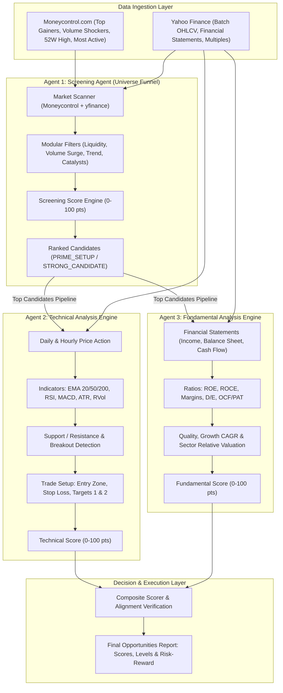

# SwingTrade AI — Multi-Agent Trading System

Deterministic multi-agent trading system for Indian equities (NSE).

- **Agent 1 — Screening Agent**: Screens and ranks Indian equities from **Moneycontrol.com** (Top Gainers, Volume Shockers, 52-Week Highs, Most Active Value, Earnings Catalysts) and **yfinance** (Universe batch scanner for EMA trend alignment, RSI swing sweet-spot, 20-day volume surge, and 52W high proximity) using a deterministic 0–100 candidate score.
- **Agent 2 — Technical Analysis Engine**: Evaluates price trends across daily and hourly timeframes, momentum, volume, breakouts (zero look-ahead bias), key S/R levels, and risk/reward setups.
- **Agent 3 — Fundamental Analysis Engine**: Evaluates quarterly & annual financial statements, revenue/PAT growth, profitability (ROE, ROCE, margins), balance sheet leverage, cash flow quality (OCF, FCF, OCF/PAT), earnings quality, and valuation multiples relative to sector medians.

---

## Architecture



---

## 1. Project Layout

```text
SwingTrade AI/
├── config/
│   ├── settings.yaml                 # Agent 2 settings & weights
│   ├── fundamental_settings.yaml     # Agent 3 settings, sector medians & weights
│   ├── screening_settings.yaml       # Agent 1 settings, universes, filters & weights
│   └── decision_settings.yaml        # Decision Engine weights, thresholds & trade execution sizing
├── data/
│   ├── raw/                          # Cached market, screening & financial data
│   └── processed/
├── outputs/
│   └── examples/
│       ├── screening_candidates.json # Agent 1 Screening output
│       ├── reliance_analysis.json    # Agent 2 Technical output
│       └── reliance_fundamental.json # Agent 3 Fundamental output
├── src/
│   ├── screening/                    # Agent 1 modules
│   │   ├── main.py                   # Screening CLI and pipeline
│   │   ├── sources/                  # Moneycontrol scraper, NSE master & yfinance batch scanner
│   │   ├── filters/                  # Technical, volume, liquidity, catalyst filters
│   │   └── output/                   # JSON formatter, table printer, pipeline dispatcher
│   ├── analysis/                     # Agent 2 technical analysis modules
│   ├── indicators/                   # Moving averages, momentum, volume, volatility
│   ├── scoring/                      # Agent 2 technical scoring
│   ├── risk/                         # Trade levels & stop-loss / targets
│   ├── fundamental/                  # Agent 3 modules
│   │   ├── main.py                   # Fundamental CLI
│   │   ├── data/                     # Financial statements & valuation metrics
│   │   ├── ratios/                   # Financial ratios (ROE, ROCE, D/E)
│   │   ├── analysis/                 # Growth, profitability, balance sheet, cash flow
│   │   ├── scoring/                  # 100-point fundamental scoring
│   │   └── output/                   # JSON formatter & LLM explainer
│   ├── decision/                     # Decision Engine modules (after Agent 2 & Agent 3)
│   │   ├── rubrics.py                # 100-point 5-dimension scoring rubrics
│   │   └── engine.py                 # Multi-agent confirmation gating, execution plan & sizing
│   ├── api/                          # FastAPI REST API & background scan service
│   └── main.py                       # Technical analysis CLI entry point
├── ui/                               # Desktop research terminal (HTML5/CSS3/ES6 JS)
├── tests/
│   ├── conftest.py
│   ├── test_decision_engine.py       # Decision Engine & scoring rubrics tests (22 tests)
│   ├── api/                          # FastAPI & UI tests (9 tests)
│   ├── screening/                    # Agent 1 screening tests (31 tests)
│   ├── test_*.py                     # Agent 2 technical tests (17 tests)
│   └── fundamental/                  # Agent 3 fundamental tests (31 tests)
├── run_all.py                        # Master runner: orchestrates Agent 1, 2, 3 and Decision Engine
├── run_screening.py                  # CLI runner for Agent 1
├── run_technical.py                  # CLI runner for Agent 2
├── run_fundamental.py                # CLI runner for Agent 3
├── run_ui.py                         # Web terminal UI launcher
├── requirements.txt
└── README.md
```

---

## 2. Installation

```bash
pip install -r requirements.txt
```

---

## 3. Usage

### Master Unified Runner (`run_all.py`)
Run the end-to-end multi-agent pipeline (Screening -> Technical -> Fundamental -> Decision Engine) with a single command:

```bash
# Run all automated tests across all agents
python run_all.py --test

# Run end-to-end pipeline offline (Screen -> Technical -> Fundamental -> Composite Verdicts)
python run_all.py --offline --top-n 3

# Run live market screening and deep pipeline analysis
python run_all.py --universe nifty50 --top-n 5

# Deep-dive on a single stock directly
python run_all.py --symbol RELIANCE --offline

# Export pipeline results as pure JSON
python run_all.py --offline --top-n 3 --json-only --output-file outputs/pipeline_run.json
```

### Agent 1: Screening Agent
```bash
# Run market screening across Moneycontrol and yfinance for NIFTY 50
python run_screening.py --universe nifty50 --min-score 60

# Screen only from Moneycontrol (Volume Shockers, 52W Highs, Top Gainers)
python run_screening.py --source moneycontrol --top-n 10

# Screen only from yfinance
python run_screening.py --source yfinance --universe nifty_next50

# Run screening with AI qualitative catalyst and news analysis
python run_screening.py --universe nifty50 --min-score 60 --llm

# Run offline with deterministic synthetic market data
python run_screening.py --offline --min-score 50

# Output pure JSON
python run_screening.py --offline --json-only

# End-to-End Multi-Agent Pipeline:
# Screen candidates with Agent 1 (with LLM catalyst) and pipe top setups directly into Agent 2 & Agent 3
python run_screening.py --offline --run-agents --top-n 3 --llm
```

### Agent 3: Fundamental Analysis Engine
```bash
# Run fundamental analysis for RELIANCE
python run_fundamental.py --symbol RELIANCE

# Run offline with cached/synthetic financials
python run_fundamental.py --symbol RELIANCE --offline

# Generate natural-language explanation
python run_fundamental.py --symbol RELIANCE --offline --explain

# Output pure JSON conforming to Section 23
python run_fundamental.py --symbol RELIANCE --offline --json-only
```

### Agent 2: Technical Analysis Engine
```bash
# Run technical analysis for RELIANCE
python run_technical.py --symbol RELIANCE

# Output pure JSON conforming to Section 19
python run_technical.py --symbol RELIANCE --offline --json-only
```

---

## 4. Testing

Run all 122+ automated unit and integration tests via pytest:
```bash
pytest -v
```

Or run tests via the master unified runner:
```bash
python run_all.py --test
```

Run specific test suites:
```bash
pytest -v tests/test_decision_engine.py  # Decision Engine & 100-point rubrics (22 tests)
pytest -v tests/api/                    # FastAPI endpoints & UI server (9 tests)
pytest -v tests/screening/              # Agent 1 screening & LLM catalyst tests (31 tests)
pytest -v tests/test_*.py               # Agent 2 technical analysis tests (17 tests)
pytest -v tests/fundamental/            # Agent 3 fundamental analysis tests (31 tests)
```

---

## 5. Continuous Integration (GitHub Actions)

Continuous integration is configured in [`.github/workflows/ci.yml`](.github/workflows/ci.yml) and runs on every push and pull request to `main` and `feature/**` branches, as well as on manual dispatch:

- **Syntax & Compilation Validation**: Compiles the entire codebase across `src/`, `config/`, tests, and root CLI runners using `compileall`.
- **Full Test Suite Matrix**: Runs the complete 122-test automated suite across Ubuntu, macOS, and Windows on both Python 3.11 and Python 3.12.
- **End-to-End CLI Smoke Tests**: Exercises Agent 1, Agent 2, Agent 3, Decision Engine, and the master runner in offline mode.
- **Decision Engine Verification**: Dedicated verification job specifically testing the 5-dimension scoring rubrics, confirmation gating rules, and trade execution plans.


